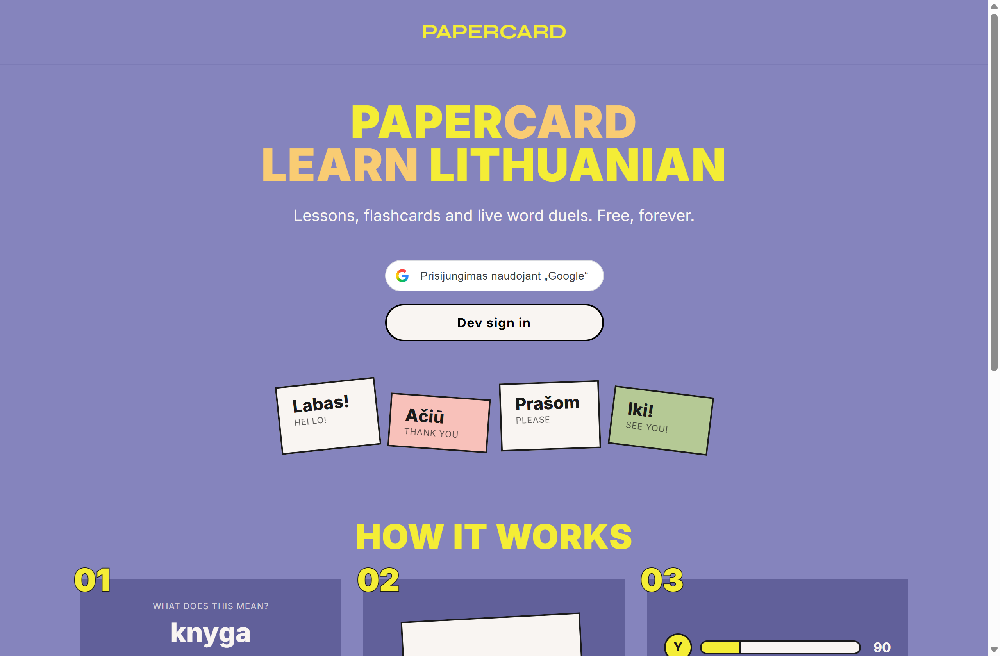
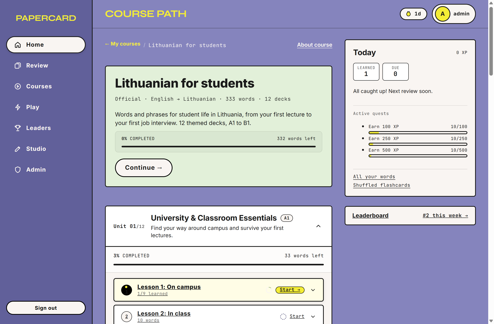
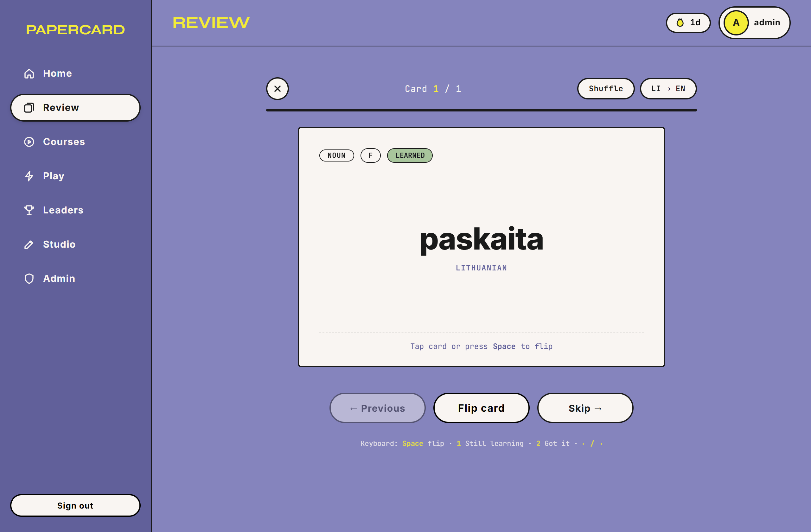
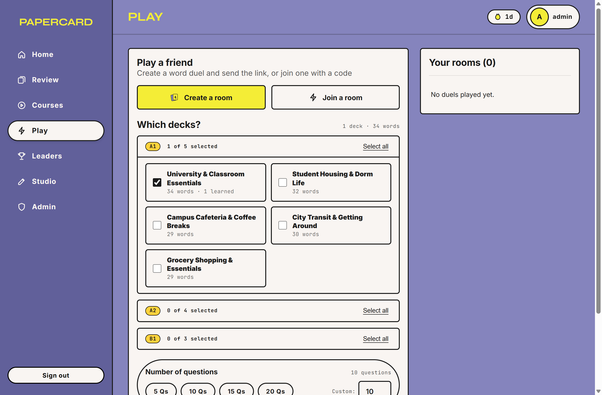
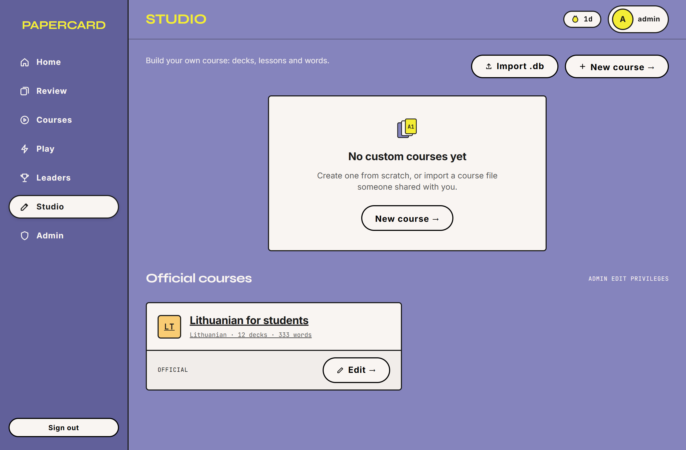
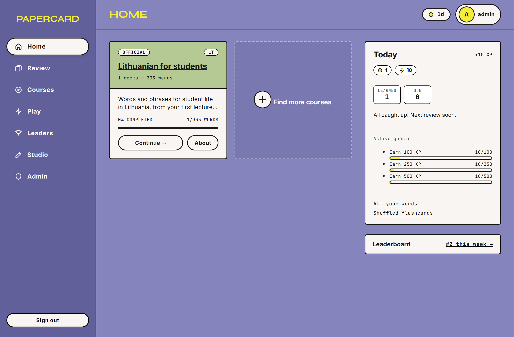
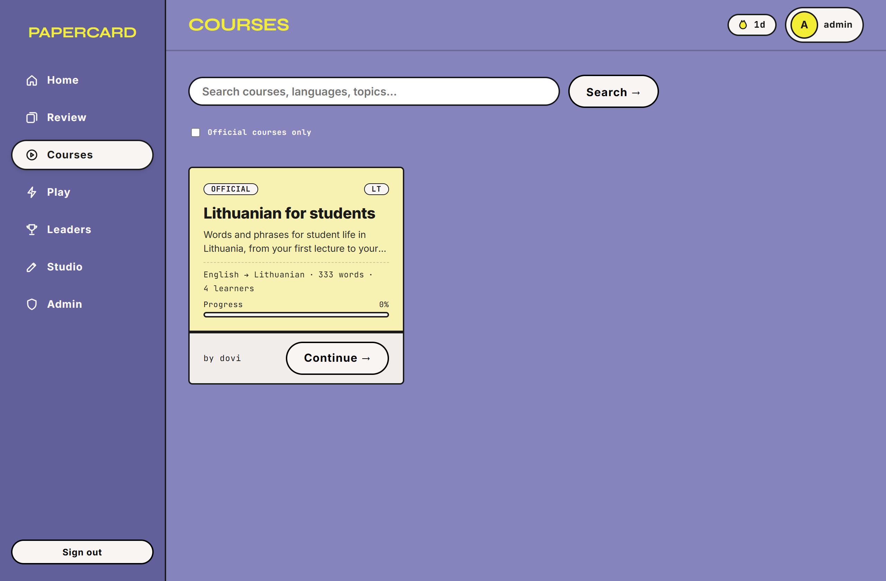

# Papercard: learn words in any language

A modern, fast, and tactile vocabulary learning platform and word duel game for any language. The official account publishes courses (starting with Lithuanian for English speakers, A1 to B1); learners take courses, follow creators, track progress with spaced repetition, and publish their own custom courses in the Studio.

<p align="center">
  
</p>

---

## Highlights

- **Learn:** A tactile path of units and lessons with XP, daily streaks, quests, and leaderboards. Lessons teach word recognition (multiple choice in both directions) and production (typing with diacritic-forgiving grading, or assembling phrases from word tiles). No artificial heart locks gating your practice.
- **Review:** Spaced repetition (SM-2 memory model). Words come back for review at expanding intervals (1 day, 3 days, etc.). Incorrect answers reset the review cycle.
- **Play (Duels):** Real-time or async multiplayer word duels. Choose decks and customize your question count (5, 10, 15, 20, or custom). Both players answer the same questions; most right answers wins, with ties decided by speed.
- **Studio & Courses:** Anyone can author and publish courses for any language in the **Studio** (`#/studio`). Features drag-and-drop course arrangement (powered by SortableJS), batch token generation for private/gated access courses, and SQLite `.db` export/import.
- **Discover & Community:** Discover courses by popularity or full-text search, follow creators, and view user profiles with achievements and statistics.
- **Admin:** Course moderation (hide/unhide courses) and direct editing of official curriculum courses.

The server is a single, blazing-fast static binary pairing **Mongoose** (C HTTP/Web server) with a **Rust** engine (`libduelcore`) and embedded **SQLite**. The frontend is built with **Svelte 5** and **Vite**, featuring a clean, responsive Riso-print aesthetic.

---

## Interface Gallery

| **Curriculum Path & Units** | **Spaced Repetition Flashcards** |
|:---:|:---:|
|  |  |
| *Visual learning tree with lessons, stars, and review status* | *SM-2 flashcard review with keyboard shortcuts & flip card* |

| **Multiplayer Word Duels** | **Creator Studio & Custom Courses** |
|:---:|:---:|
|  |  |
| *Real-time battle lobby with customizable question count (5–50)* | *Author decks, import/export .db files, and manage course access* |

| **Learning Dashboard** | **Discover & Search Catalog** |
|:---:|:---:|
|  |  |
| *Enrolled courses, active streaks, daily quests, and leaderboards* | *FTS5 full-text search across titles, creators, and vocabulary* |

---

## Quick Start

### 1. Requirements
- [Docker](https://docs.docker.com/) or [Podman](https://podman.io/) with Compose support (`docker compose` or `podman compose`).
- Node.js 20+ (only required if developing the frontend locally without containers).

### 2. Run with Compose

```sh
# Copy environment configuration
cp .env.example .env

# Run using Podman Compose or Docker Compose
podman compose up -d --build
# or: docker compose up -d --build
```

Open [http://localhost:8080](http://localhost:8080) in your browser.

### 3. Local Development (Guest Logins)

To test locally without setting up Google OAuth:

```sh
ALLOW_DEV_LOGIN=1 ADMINS=dev:alice podman compose up -d --build
```

You can now click **"Sign in as guest"** or sign in directly with test accounts like `alice` or `bob`. Guest admins specified in `ADMINS=dev:<name>` have immediate access to `#/admin`.

---

## Frontend Development

The frontend is located in `frontend/` and built with **Svelte 5** (Runes syntax) and **Vite**:

```sh
cd frontend
npm install
npm run dev
```

During development with `npm run dev`, Vite runs on port `5173` and proxies API requests (`/api/*`) to the backend running at `http://localhost:8080`.

To build the static frontend bundle:

```sh
npm run build
```

The production assets will be output to `frontend/dist/`.

---

## Features & System Details

### Courses, Accounts & Follows
- **Authentication:** Google OAuth 2.0 (RS256 ID tokens verified locally by the Rust engine) and optional guest dev login.
- **Official Account:** A built-in system account (`@labas` / `@vokab`, configured via `OFFICIAL_NAME`) owns the starter curriculum. Site admins manage official courses.
- **Studio:**
  - Create up to 20 courses per user.
  - **Arrange Board:** Interactive board with columns (decks) and cards (lessons) for reordering and moving lessons and words across decks.
  - **Access Codes:** Creators can lock courses and generate batches of single-use access tokens (`K7QX4-M2PRT-9HZBN`) with downloadable text manifests.
  - **Course Portability:** Export courses as standalone SQLite `.db` files (`labas-course-1` format) or import `.db` packages.
- **Search:** Full-Text Search (SQLite FTS5 with trigram tokenizer) over course titles, descriptions, creators, deck names, and all vocabulary terms and synonyms. Accents and casing are folded across all scripts.
- **Spaced Repetition & Reviews:** Powered by the SuperMemo SM-2 algorithm, scheduling words based on user recall quality.
- **Duels:** Configurable question counts with instant room sharing via room codes or invite links.

### The Starter Course
The starter course is loaded on first startup from `server/seed.json` (12 decks across A1–B1 levels with 330+ words and phrases covering Lithuanian to English). Each word includes part of speech, gender tags, accepted alternative spellings, and contextual notes.

---

## Configuration (`.env`)

| Variable | Description | Default |
|---|---|---|
| `PORT` | Local host port mapped to the server container | `8080` |
| `GOOGLE_CLIENT_ID` | OAuth 2.0 Client ID for Google Sign-In | `""` |
| `ALLOW_DEV_LOGIN` | `1` to allow instant guest/dev sign-in box | `0` |
| `ADMINS` | Comma-separated admin identifiers (`you@gmail.com,dev:alice`) | `""` |
| `COOKIE_SECURE` | Set to `1` when running behind HTTPS/SSL | `0` (or `1` in prod) |
| `DOMAIN` | Domain for Dokploy / Traefik routing | `""` |
| `OFFICIAL_NAME` | Display name of the official platform account | `Vokab` |

---

## Architecture

```
                    ┌──────────────────────────────────────────────┐
                    │               Browser Client                 │
                    │         (Svelte 5 + Vite SPA)                │
                    └──────────────────────┬───────────────────────┘
                                           │ HTTP / Static Assets
                                           ▼
┌──────────────────────────────────────────────────────────────────────────┐
│                         Papercard Static Binary                          │
│                                                                          │
│  ┌───────────────────────┐                  ┌─────────────────────────┐  │
│  │     Mongoose (C)      │                  │    Rust libduelcore     │  │
│  │ • HTTP & routing      │◄────────────────►│ • Exercises & decoy gen │  │
│  │ • SQLite persistence  │                  │ • Answer grading        │  │
│  │ • Sessions & auth     │                  │ • Duel view & scoring   │  │
│  │ • Learn & Studio APIs │                  │ • Google token verify   │  │
│  └───────────┬───────────┘                  └─────────────────────────┘  │
└──────────────┼───────────────────────────────────────────────────────────┘
               │
        ┌──────┴──────┐
        ▼             ▼
  ┌───────────┐ ┌───────────┐
  │  SQLite3  │ │ memcached │
  │  (/data)  │ │ (sessions)│
  └───────────┘ └───────────┘
```

| Component | Path | Description |
|---|---|---|
| **Frontend** | `frontend/` | Svelte 5 single-page application with tactile Riso styling. |
| **HTTP Server** | `server/main.c` | Core Mongoose server, sessions, routing, guest/Google sign-in, duels. |
| **Learning & Studio** | `server/learn.c` | Lessons, review scheduling (SM-2), quests, XP, streaks, and Studio APIs. |
| **Courses & Social** | `server/courses.c` | Course listing, CRUD, follows, user profiles, and admin moderation. |
| **Core Engine** | `engine/src/vocab.rs` | Exercise generation, decoy choices, and typo-tolerant answer grading. |
| **Duel Engine** | `engine/src/view.rs` | Duel turn scoring, game-over resolution, and perspective filtering. |
| **Auth Verifier** | `engine/src/google.rs` | Offline cryptographic verification of Google ID tokens (RS256). |

---

## Production Deployment

### Multi-Stage Container Build
The provided `Containerfile` performs a hermetic 3-stage build:
1. **Frontend build:** Compiles Svelte 5 application via Vite to static HTML/CSS/JS.
2. **Backend build:** Builds the Rust static engine library (`libduelcore.a`) and statically links it with Mongoose C code and SQLite.
3. **Runtime:** Lean Alpine Linux image (`< 30MB`) running as non-root user `papercard`.

### Deploy with Dokploy
1. Point your Dokploy project to the Git repository.
2. In Dokploy, set the container compose or Containerfile build path.
3. Add environment variables (`DOMAIN`, `GOOGLE_CLIENT_ID`, `COOKIE_SECURE=1`, `ADMINS`).
4. Dokploy’s Traefik reverse proxy handles automatic Let's Encrypt SSL/TLS termination and forwards traffic to the application.

---

## Testing

```sh
# 1. Rust engine unit & course validation tests
podman run --rm -v "$PWD/engine:/src" -v "$PWD/server:/server:ro" -w /src \
  -e CARGO_TARGET_DIR=/tmp/target docker.io/library/rust:1-alpine \
  sh -c 'apk add musl-dev && cargo test --release'

# 2. API integration tests (requires server running with ALLOW_DEV_LOGIN=1)
node tests/test_api.mjs http://localhost:8080

# 3. Headless browser end-to-end tests
node tests/test_browser.mjs http://localhost:8080/ out/
```
